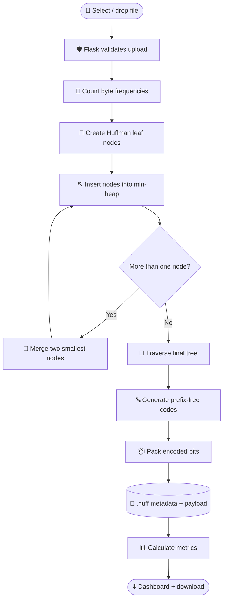
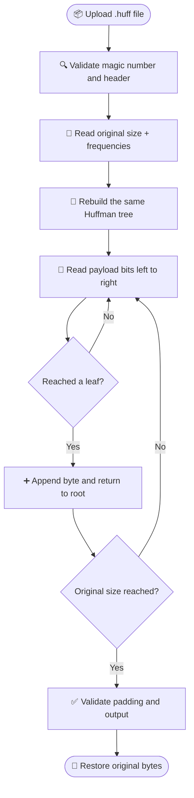

# 🗜️ Smart File Compression Workbench

<p align="center">
  <strong>Explore • Compress • Measure • Verify</strong><br>
  <em>A visual DAA project demonstrating greedy algorithms through lossless file compression.</em>
</p>

<p align="center">
  
  
  
  
</p>

> 🎓 **Teacher-ready summary:** This project is not only a file compressor. It is an
> interactive algorithm workbench that makes the greedy choice, priority queue,
> Huffman tree, prefix codes, complexity, and measured performance visible.

<table>
<tr>
<td align="center">📦<br><strong>Lossless</strong><br><sub>Exact byte restoration</sub></td>
<td align="center">🌳<br><strong>Tree-based</strong><br><sub>Binary Huffman tree</sub></td>
<td align="center">⚡<br><strong>Measured</strong><br><sub>Time and size metrics</sub></td>
<td align="center">✅<br><strong>Verified</strong><br><sub>Integrity checking</sub></td>
</tr>
</table>

### 🧭 Quick navigation

| | Section | What it explains |
|---|---|---|
| 🎤 | [Teacher pitch](#1-one-minute-explanation-for-the-teacher) | How to introduce the project |
| 🔄 | [Project flow](#2-complete-project-flow) | What happens from upload to download |
| 🧩 | [Implementation map](#3-how-the-implementation-is-divided) | Role of every project file |
| 🌳 | [Huffman algorithm](#4-huffman-implementation-step-by-step) | How the algorithm works |
| 📊 | [DAA analysis](#6-daa-analysis-to-explain) | Complexity and greedy proof |
| 🎬 | [Demo script](#7-demonstration-procedure) | How to present the application |
| ❓ | [Viva questions](#8-questions-the-teacher-may-ask) | Short answers for evaluation |

## 1. 🎤 One-minute explanation for the teacher

Our project is a web-based file compression workbench based on **Huffman Coding**.
Huffman Coding is a greedy algorithm that assigns shorter binary codes to frequent
bytes and longer codes to less frequent bytes. The application compresses arbitrary
files without losing data, decompresses the generated `.huff` file, verifies the
restored bytes, and reports measurable performance statistics.

> ⭐ **Our DAA contribution:** We implement the frequency table,
min-heap, Huffman tree, code generation, bit packing, and decoding. We do not use
Python's `zipfile`, `gzip`, or another ready-made compression algorithm.

## 2. 🔄 Complete project flow

### Compression pipeline



<details>
<summary>📋 Open the detailed compression flow</summary>

```text
User selects or drops a file
              |
              v
       Flask upload route
       - validates file
       - enforces 16 MB limit
              |
              v
       Read file as raw bytes
              |
              v
       Count frequencies for byte values 0..255
              |
              v
       Create one Huffman leaf per distinct byte
              |
              v
       Insert leaves into a min-heap
              |
              v
       Repeatedly remove two smallest nodes
       and merge them into a parent node
              |
              v
       Traverse the final binary tree
       0 = left edge, 1 = right edge
              |
              v
       Generate prefix-free byte-to-code map
              |
              v
       Replace input bytes with their codes
       and pack bits into output bytes
              |
              v
       Store metadata + encoded payload
       as a self-describing .huff stream
              |
              v
       Calculate size, ratio, savings, and time
              |
              v
       Return dashboard data and download link
```

</details>

### Decompression pipeline



<details>
<summary>📋 Open the detailed decompression flow</summary>

```text
.huff file uploaded
        |
        v
Validate magic number and header
        |
        v
Read original size and 256 frequencies
        |
        v
Rebuild the same Huffman tree
        |
        v
Read payload bits from left to right
        |
        v
Reach a leaf -> append that byte -> return to root
        |
        v
Check payload length, padding, and output size
        |
        v
Return original bytes and integrity_verified = true
```

</details>

## 3. 🧩 How the implementation is divided

| File | Responsibility |
|---|---|
| 🧠 [`algorithms/huffman.py`](algorithms/huffman.py) | Core DAA algorithm: frequencies, min-heap, tree, codes, encoding, decoding, validation |
| 📈 [`services/benchmark.py`](services/benchmark.py) | Reusable compression/decompression timing for multiple files |
| 🌐 [`app.py`](app.py) | Flask routes, upload validation, metrics, downloads, and error responses |
| 🖥️ [`templates/index.html`](templates/index.html) | Dashboard structure and teacher-facing algorithm explanation |
| ⚙️ [`static/app.js`](static/app.js) | File selection, API calls, result rendering, code-table rendering |
| 🎨 [`static/style.css`](static/style.css) | Responsive visual presentation |
| 🧪 [`tests/test_huffman.py`](tests/test_huffman.py) | Correctness, edge cases, prefix property, and corruption tests |
| 📦 [`requirements.txt`](requirements.txt) | Flask and pytest dependencies |

## 4. 🌳 Huffman implementation, step by step

### ① Frequency counting

The input is processed as `bytes`, not as text. A 256-element counter records the
number of occurrences of every possible byte value. This supports text, images,
PDFs, and other binary files.

```text
for each byte x in input:
    frequency[x] += 1
```

> ⏱️ **Time:** `O(n)`, where `n` is the number of input bytes.

### ② Build the min-heap

Each distinct byte becomes a leaf node containing its frequency. Nodes are inserted
into Python's binary heap, which provides the min-priority-queue operation required
by Huffman's greedy method.

### ③ Make the Huffman tree

```text
while heap contains more than one node:
    left  = remove minimum-frequency node
    right = remove minimum-frequency node
    parent = node with frequency left.frequency + right.frequency
    parent.left = left
    parent.right = right
    insert parent into heap
```

> 🟣 **Greedy choice:** The two least frequent nodes are combined at every step.
The final tree has one leaf for each distinct byte.

### ④ Generate codes

The tree is traversed recursively:

- left edge adds `0`
- right edge adds `1`
- reaching a leaf saves the current path as that byte's code

Because codes are assigned only to leaves, no code is a prefix of another code.
This is the prefix-free property that makes decoding unambiguous.

The single-symbol case receives code `0`, and empty input produces an empty tree.

### ⑤ Encode bits

The input bytes are replaced using the generated code table. Bits are accumulated
into groups of eight and stored as bytes. The final byte is padded with zero bits
when necessary.

### ⑥ Store metadata

The `.huff` format contains:

```text
4 bytes   magic value: HUF1
8 bytes   original input size
2048 bytes frequency table: 256 unsigned 64-bit frequencies
remaining bytes encoded Huffman payload
```

> 💡 The frequency table is deliberately included so the decoder can rebuild the tree
without needing the original input file or an in-memory object.

## 5. 📊 Metrics shown by the application

Let:

- `S_o` = original file size in bytes
- `S_c` = complete compressed stream size, including metadata

```text
Compression ratio = S_o / S_c
Space savings     = ((S_o - S_c) / S_o) * 100
```

> ⚠️ **Important observation:** The application reports the complete `.huff` size.
Small files can become larger
because the metadata header is larger than the encoded payload. This is expected
and is an important experimental observation.

The benchmark also measures compression time, decompression time, and whether the
decompressed data is exactly equal to the input.

## 6. 🧮 DAA analysis to explain

For `n` input bytes and `k` distinct byte values:

| Operation | Complexity |
|---|---|
| Frequency counting | `O(n)` |
| Heap initialization | `O(k)` |
| Huffman tree construction | `O(k log k)` |
| Code generation | `O(k)` |
| Encoding | `O(n + B)` in the bit-oriented implementation |
| Decoding | `O(B)` |
| Frequency/tree/code auxiliary space | `O(k)` |

`B` is the number of encoded bits. Because the project uses a byte alphabet,
`k` is at most 256, although the analysis is written for a general alphabet.

### Complexity at a glance

```text
Input bytes (n) ──► Frequency counting ──► O(n)
Distinct symbols (k) ──► Min-heap + tree ──► O(k log k)
Encoded bits (B) ──► Decode ──► O(B)
```

### Why the greedy choice works

The two least frequent symbols can be placed at the deepest sibling leaves in an
optimal prefix-code tree. Combining them into one parent creates a smaller
equivalent problem. Repeating this reduction produces an optimal prefix code.
This is the greedy-choice property and optimal-substructure argument behind
Huffman Coding.

## 7. 🎬 Demonstration procedure

1. 🚀 Start the server with `python app.py`.
2. 🌐 Open `http://127.0.0.1:5000`.
3. 📄 Select a text file with repeated words.
4. 🗜️ Click **Compress with Huffman**.
5. 📊 Explain the original size, compressed size, ratio, space savings, timing, and
   generated codes.
6. ⬇️ Download the `.huff` file.
7. 🔁 Upload it to a decompression route/API if demonstrating the backend directly.
8. ✅ Show that the restored output has `integrity_verified = true`.
9. 🧪 Repeat with a binary file or already-compressed file.
10. 💬 Explain why the ratio may be poor for a small or already-compressed file.
11. 🧪 Run the test suite with `python -m pytest -q`.

Useful API routes:

| Method | Route | Purpose |
|---|---|---|
| `GET` | `/` | Open the dashboard |
| `POST` | `/api/compress` | Compress an uploaded file |
| `POST` | `/api/decompress` | Restore a `.huff` file |
| `POST` | `/api/inspect` | Return frequencies and tree information |
| `POST` | `/api/benchmark` | Measure compression, decompression, and integrity |
| `GET` | `/download/<token>` | Download a generated result |

## 8. ❓ Questions the teacher may ask

### Why is Huffman Coding greedy?

At each step it selects the two least frequent nodes. This local choice can be
proven safe because those two symbols can be siblings at maximum depth in an
optimal prefix tree.

### Why do we need the frequency table in the compressed file?

The decoder must reconstruct the same tree. Without the metadata, it cannot know
which bit path represents which byte.

### Why is a compressed file sometimes larger?

Our stream includes a 2056-byte header. For small inputs, that metadata overhead can
be greater than the reduction from variable-length coding.

### Why can arbitrary binary files be supported?

The algorithm reads raw byte values from 0 through 255 and never decodes the input
using a text encoding.

### How do you know decompression is correct?

The decoder validates the header, payload length, padding, and expected output
size. The benchmark additionally compares restored bytes with the original bytes.

### What is the difference between theoretical and measured performance?

The complexity describes how operations grow with input size. Measured time also
depends on hardware, Python overhead, file content, memory, and operating-system
load. The application reports both the theoretical analysis and actual timings.

## 9. 🚀 Current limitations and future work

- The current application limits uploads to 16 MB for safe local demonstrations.
- The download store is memory-based and is intended for local academic use.
- The initial release implements Huffman Coding only.
- LZW, persistent benchmark history, streaming large-file support, and tree graphics
  can be added as future enhancements.
